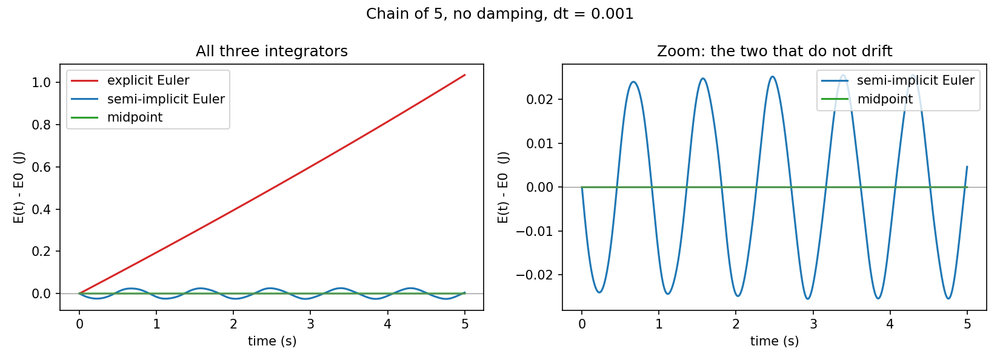

# diffphys — Differentiable Physics Simulation

GPU-accelerated differentiable physics simulation: infra layer for physical AI
(simulation, Sim2Real).

## Status

a NumPy (float64, CPU) 3D mass–spring simulator with three
integrators, validated against analytic physics. It is the reference implementation the later GPU (NVIDIA Warp) version will be checked against.

## Plan

- [x] NumPy mass-spring simulation (semi-implicit Euler) running
- [x] Public repo skeleton + README

Next: port to NVIDIA Warp, single-scene differentiability, trajectory
optimization, Newton PRs, gradient-quality benchmark.

## Quick start

```bash
python3 -m venv .venv && source .venv/bin/activate
pip install -r requirements.txt
python -m pytest -q                 # 55 tests
python -m scripts.check_cases       # acceptance cases A, A2, B, C -> ALL PASS
python -m scripts.plot_energy       # writes figures/energy_comparison.png
```

## Physics model

- State: positions `x` (N, 3), velocities `v` (N, 3), inverse masses (`0` = pinned). y is up.
- Spring `(i, j)`: `d = x_j - x_i`, `L = |d|`, `n = d / L`,
  `f = [k_s (L - L0) + k_d (v_j - v_i)·n] n`, added to `i`, subtracted from `j`.
- Gravity `m g` on free particles; global drag `-c v`.
- Integrators: explicit Euler, semi-implicit (symplectic) Euler (default), midpoint.

## Validation

| Check | Analytic | Measured |
|---|---|---|
| Oscillator period | 2π√(m/k) = 0.6283 s | 0.6283 s |
| Energy, semi-implicit, 4 s | bounded | max deviation 0.50 % |
| Energy after 2 s: explicit / semi-implicit / midpoint | grows / bounded / ≈ flat | +22.1 % / −0.4 % / +0.0 % |
| Hanging mass length | L0 + mg/k = 1.0981 m | 1.0981 m |
| Chain of 5, spring lengths | 0.6924 / 0.5943 / 0.4962 / 0.3981 m | same to 4 decimals |
| Momentum, free pair | conserved | change < 1e-10 |
| Damped peaks | 0.1·e^(−0.5 t) | within 0.1 % |



## Layout

- `src/mass_spring.py` — `SpringSystem`, forces (vectorized + loop reference),
  integrators, `simulate`, factories, `measure_period`
- `tests/` — validation, forces, integrators, physics laws, vectorized-vs-loop
- `scripts/` — `check_cases.py` (acceptance), `plot_energy.py` (figure)
- `figures/` — generated figures
- `Guides/` — spec, task list, expected output, build guide
