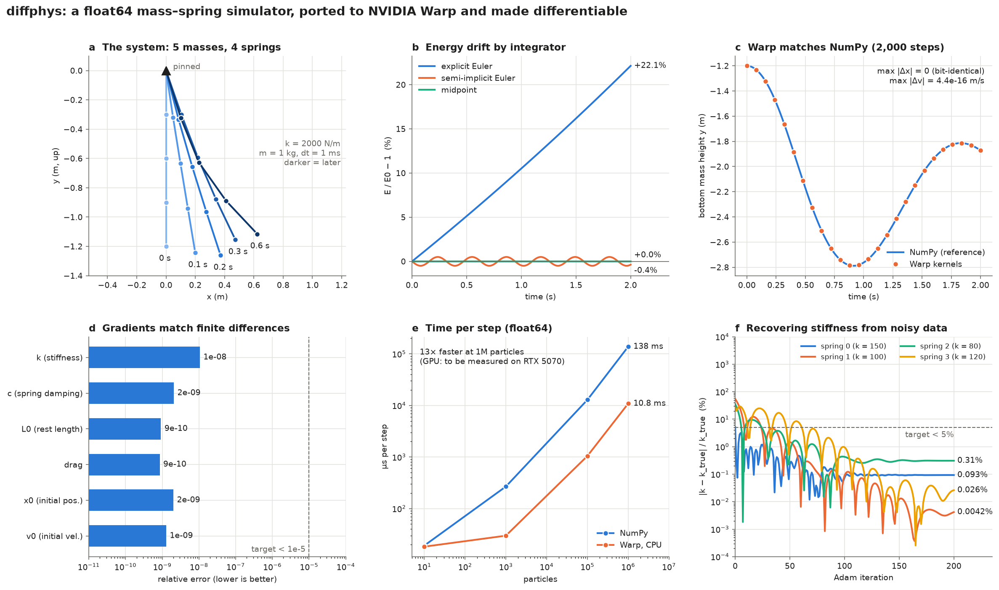
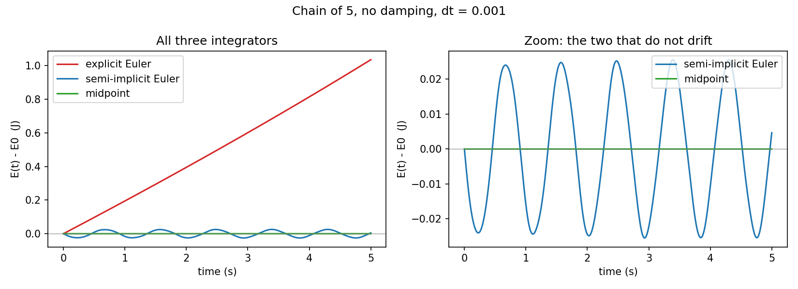
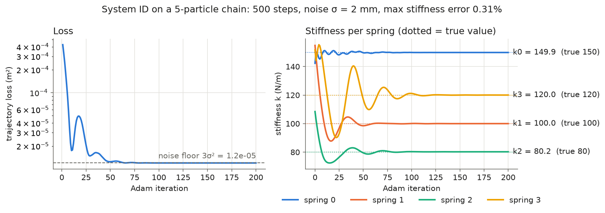

# diffphys — Differentiable Mass–Spring Simulation

[](https://github.com/ynohtna9918/diffphys-spring-euler/actions/workflows/test.yml)

A 3D mass–spring simulator in two layers: a float64 NumPy reference
implementation, and an NVIDIA Warp (GPU) version that is checked against it
and made differentiable with `wp.Tape`. The gradients are then used to
recover unknown spring stiffnesses from a noisy trajectory.



*Every panel is computed live from the code in this repository:
`python -m scripts.plot_overview` (about 30 s on a laptop CPU).*

| | Panel | Result |
|---|---|---|
| **Physics** | a, b | 5-mass chain under gravity. Semi-implicit Euler keeps energy within ±0.5% while explicit Euler gains 22.1% in 2 s |
| **Warp port** | c | Same trajectory as NumPy after 2,000 steps: positions bit-identical, max \|Δv\| = 4.4e-16 m/s |
| **Gradients** | d | `wp.Tape` autodiff vs central finite differences, six parameter groups: worst relative error 1.1e-8 (target < 1e-5) |
| **Speed** | e | Warp on CPU is about 10–13× faster than NumPy at 1,000,000 particles (GPU numbers pending) |
| **System ID** | f | Four stiffnesses recovered from 2 mm-noise data: worst error 0.31% here, 0.81% over 8 random starts (target < 5%) |

## Status

- **Done:** NumPy (float64, CPU) reference simulator with three integrators,
  validated against analytic physics. Warp port that matches it to 4.4e-16,
  gradients through `wp.Tape` that match finite differences to 1.1e-8, and a
  system-identification demo that recovers spring stiffness within 0.81%.
  77 tests. One-page write-up: [`docs/v1_note.md`](docs/v1_note.md).
- **Remaining for v1:** the same tests and a benchmark on `cuda:0` (RTX 5070),
  CI live on GitHub, and the `v1.0` tag.

## v1 scope (target: early December 2026)

v1 is deliberately small: a differentiable simulator plus one result showing
the gradients are useful. It is done when every box below is ticked.

- [x] NumPy reference: forces, three integrators, factories, 55 tests
- [x] Acceptance cases A, A2, B, C pass; integrator energy figure
- [ ] Warp forward simulator matches NumPy (Case C, 2000 steps:
      max |Δx|, |Δv| < 1e-10) on CPU and `cuda:0`; `check_cases --warp` ALL PASS
      — CPU done (max |Δv| 4.4e-16); `cuda:0` not yet run
- [ ] GPU benchmark from 10 to 1,000,000 particles
- [x] Gradients through `wp.Tape`: autodiff vs central finite differences
      (float64) for k, c, L0, x0, v0, relative error < 1e-5 (worst: 1.1e-8)
- [x] System identification: recover spring stiffness from a noisy
      trajectory, error < 5% (worst of 8 seeds: 0.81%)
- [ ] CI runs the test suite on every push — workflow written and passed one
      run on GitHub Actions; live once pushed
- [ ] One-page technical note (`docs/v1_note.md`); tag `v1.0` — note written

## Future work (out of scope for v1)

Batching many systems per launch (B ≥ 1,024), smooth ground contact,
cube/voxel builders and actuation, soft-robot locomotion, a first- vs
zeroth-order gradient-quality study, a cross-check against DiffTaichi, and
contributions to Newton.

## Quick start

```bash
python3 -m venv .venv && source .venv/bin/activate
pip install -r requirements.txt
python -m pytest -q                 # 77 tests (more on a machine with CUDA)
python -m scripts.check_cases       # acceptance cases A, A2, B, C -> ALL PASS
python -m scripts.check_cases --warp [--device cuda:0]   # A, B, C on Warp
python -m scripts.gradcheck         # autodiff vs finite differences, eps sweep
python -m scripts.system_id         # writes figures/system_id.png
python -m scripts.bench_warp        # time per step, NumPy vs Warp
python -m scripts.plot_energy       # writes figures/energy_comparison.png
python -m scripts.plot_overview     # writes figures/overview.png
```

## Physics model

- State: positions `x` (N, 3), velocities `v` (N, 3), inverse masses (`0` = pinned). y is up.
- Spring `(i, j)`: `d = x_j - x_i`, `L = |d|`, `n = d / L`,
  `f = [k_s (L - L0) + k_d (v_j - v_i)·n] n`, added to `i`, subtracted from `j`.
- Gravity `m g` on free particles; global drag `-c v`.
- Integrators: explicit Euler, semi-implicit (symplectic) Euler (default), midpoint.

## Validation

| Check | Analytic | Measured |
|---|---|---|
| Oscillator period | 2π√(m/k) = 0.6283 s | 0.6283 s |
| Energy, semi-implicit, 4 s | bounded | max deviation 0.50 % |
| Energy after 2 s: explicit / semi-implicit / midpoint | grows / bounded / ≈ flat | +22.1 % / −0.4 % / +0.0 % |
| Hanging mass length | L0 + mg/k = 1.0981 m | 1.0981 m |
| Chain of 5, spring lengths | 0.6924 / 0.5943 / 0.4962 / 0.3981 m | same to 4 decimals |
| Momentum, free pair | conserved | change < 1e-10 |
| Damped peaks | 0.1·e^(−0.5 t) | within 0.1 % |
| Two free masses, period | 2π√(μ/k) = 0.4443 s | error 8e-6 |
| Energy, semi-implicit, 10,000 steps | bounded | max deviation 0.50 % |
| Warp vs NumPy, chain of 5, 2000 steps | identical | max \|Δv\| 4.4e-16 |
| Gradients vs central finite differences | equal | worst relative error 1.1e-8 |
| System ID, 4 stiffnesses, 2 mm noise | 150 / 100 / 80 / 120 N/m | worst error 0.81 % (8 seeds) |





## Layout

- `src/mass_spring.py` — `SpringSystem`, forces (vectorized + loop reference),
  integrators, `simulate`, factories, `measure_period`
- `src/warp_sim.py` — Warp kernels, `WarpModel`, `simulate_warp`, differentiable
  `rollout`, `loss_and_grad`
- `src/gradcheck.py` — finite-difference gradient check
- `src/system_id.py` — stiffness recovery with Adam
- `tests/` — validation, forces, integrators, physics laws, vectorized-vs-loop,
  Warp vs NumPy, gradients, system ID
- `scripts/` — `check_cases.py` (acceptance, `--warp`), `gradcheck.py`,
  `system_id.py`, `bench_warp.py`, `plot_energy.py`, `plot_overview.py`,
  `warp_smoke.py`
- `docs/v1_note.md` — one-page technical note
- `figures/` — generated figures
- `Guides/` — spec, task list, expected output, build guide

## Acknowledgments

I developed the mass–spring simulation: the physics model, the NumPy
implementation in `src/mass_spring.py` with its three integrators, and the
acceptance cases and tests that validate it against analytic physics. An AI
assistant helped with a few helper functions and tests on request.

I used an AI coding assistant to write this README and the guides in
`Guides/`, and for much of the NVIDIA Warp work: the Warp port of the
simulator, the gradient checks, the system-identification demo, the CI
workflow and the figure scripts. Every number in this repository comes from
running its code, and the tests pin those numbers down.
