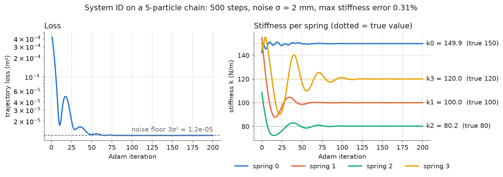

# diffphys v1: a differentiable mass–spring simulator in NVIDIA Warp

Anthony · December 2026 · <https://github.com/ynohtna9918/diffphys-spring-euler>

## Problem

Gradient-based system identification and control need a simulator whose
outputs can be differentiated with respect to physical parameters. v1 asks
a narrow question: can a small GPU mass–spring simulator give gradients that
are (a) correct to near machine precision and (b) good enough to recover
unknown physical parameters from noisy data?

## Method

- **Model.** Particles joined by damped springs:
  `f = [k_s (L − L0) + k_d (v_j − v_i)·n] n`, with gravity, linear drag and
  pinned particles (inverse mass 0). Semi-implicit (symplectic) Euler,
  `dt = 1 ms`, float64 throughout.
- **Two implementations.**
  1. A NumPy reference (`src/mass_spring.py`), validated against analytic
     physics.
  2. A Warp port (`src/warp_sim.py`): one kernel each for external forces,
     spring forces (atomic scatter) and integration.
- **Gradients.** `wp.Tape` records a rollout in which every step writes new
  position, velocity and force arrays, so the backward pass never reads an
  overwritten value. Stiffness, spring damping and rest length are
  per-spring arrays; drag is a 1-element array. All of them, plus the
  initial positions and velocities, receive gradients.
- **System ID.**
  - Setup: a 5-particle chain hangs from a pin. True stiffness is
    `[150, 100, 80, 120] N/m`. It is released at rest spacing and observed
    for 0.5 s with 2 mm Gaussian position noise.
  - Fit: Adam on log k (learning rate 0.05, 200 iterations) minimizes the
    mean squared trajectory error, starting from guesses drawn 0.5×–2× off.

## Validation

Each layer is checked against something independent of it. There are 77
tests, which run in CI on every push.

| Layer | Checked against | Result |
|---|---|---|
| NumPy simulator | Analytic period, reduced-mass period, static sag, momentum, damped envelope | All match (worst: damped peaks within 0.1%); energy drift < 1% over 10,000 steps |
| Warp forward | NumPy, same initial state, chain of 5, 2,000 steps | max \|Δx\| = 0, max \|Δv\| = 4.4e-16 |
| Gradients | Central finite differences, ε = 1e-4 … 1e-7 | Worst relative error 1.1e-8 (200 steps), 1.2e-9 (1,000 steps) |

The test suite was also mutation-tested: deliberate bugs are inserted to
confirm that some test fails. Two examples:

- Wrong sign in Newton's third law: caught.
- Every spring using spring 0's stiffness: caught only after adding a
  per-spring forward test. A gradient check alone cannot catch it, because
  autodiff and finite differences then agree about the wrong model.

## Results

*Regenerate with `python -m scripts.system_id --seeds 8`.*

- **4.4e-16.** Largest velocity difference between the Warp and NumPy
  trajectories after 2,000 steps.
- **1.1e-8.** Worst relative error between autodiff and finite-difference
  gradients, across k, damping, rest length, drag, x0 and v0.
- **0.81%.** Worst stiffness error over 8 random initial guesses. The
  target was 5%. The final loss equals the noise floor 3σ², so the fit
  explains everything except the noise.

Speed per step, chain of N particles (float64):

| N | NumPy | Warp, Mac CPU (Apple silicon) | Warp, RTX 5070 |
|---:|---:|---:|---:|
| 10 | 18 µs | 18 µs | *to be measured* |
| 1,000 | 129 µs | 29 µs | *to be measured* |
| 100,000 | 12.6 ms | 0.93 ms | *to be measured* |
| 1,000,000 | 135 ms | 9.3 ms | *to be measured* |

## Limitations

- **Identifiability depends on the observation window.** With 0.3 s of data
  instead of 0.5 s, the two lower springs come back 25–64% off. The loss is
  then nonconvex in k, and a longer horizon also makes gradients grow.
- **Only stiffness is identified.** Masses, damping and the initial state
  are assumed known.
- **One system per launch, float64, no contact.** GeForce GPUs run float64
  at roughly 1/64 of float32 speed. Large-scale use would need float32 and
  batching.
- **Warp's overwrite detector did not flag the reads in these kernels.**
  `wp.config.verify_autograd_array_access` missed them in Warp 1.18, so the
  finite-difference test is the real guard. Reusing one force array across
  steps happens to give identical gradients here: `F` is fully overwritten
  each step and masses are not differentiated. v1 still allocates one per
  step.

## Future work

1. Batch B ≥ 1,024 systems per launch.
2. Smooth ground contact.
3. Cube/voxel builders with actuation for soft-robot locomotion.
4. A study of first-order (autodiff) versus zeroth-order (evolution
   strategies) gradient quality across stiffness and horizon.
5. A cross-check against DiffTaichi.
